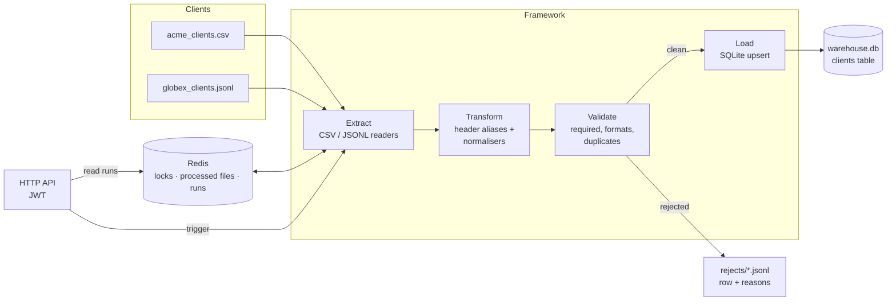
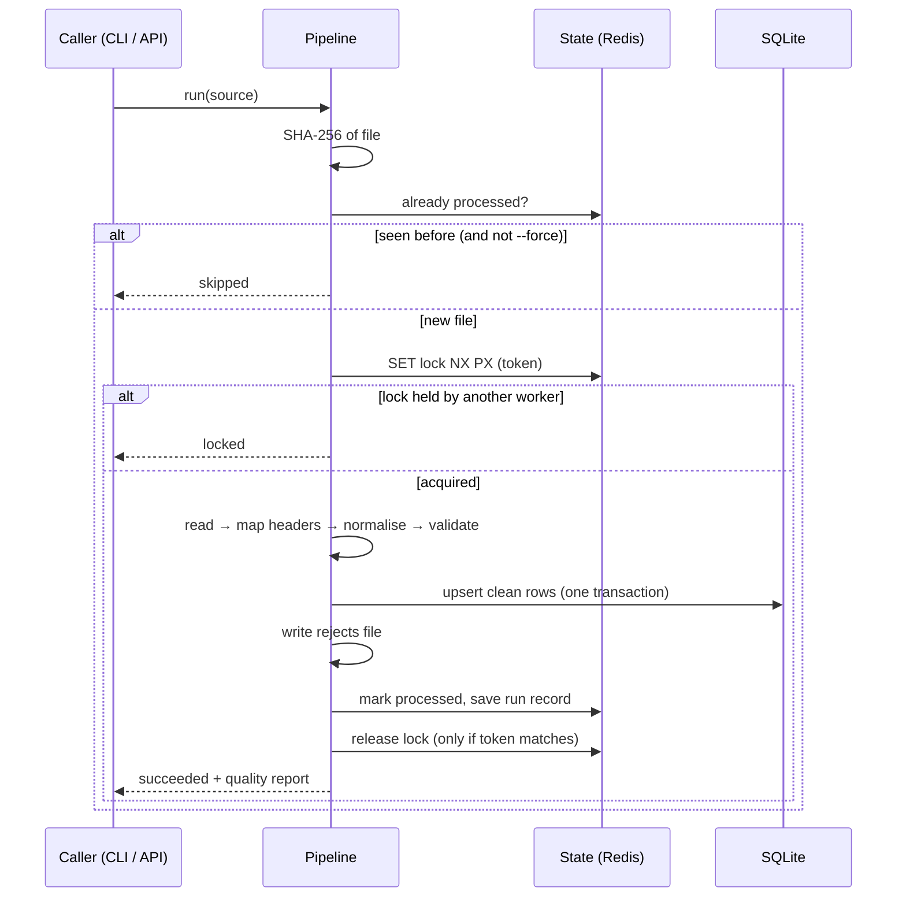
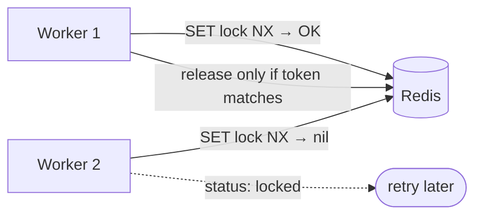
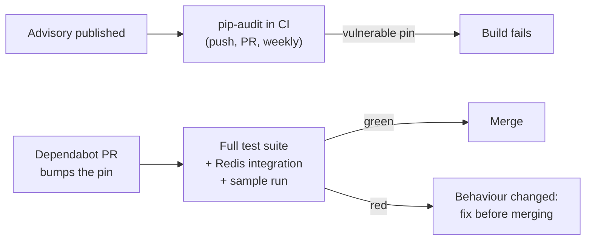

# ETL Ingestion Framework

A config-driven framework for ingesting client data files that all describe the same thing in different shapes. It maps each client's columns onto one standard schema, normalises every value (emails, phone numbers, country codes, dates, money, yes/no), rejects bad records with a reason for each, and loads the clean ones idempotently. Run state lives in **Redis** so several workers can share the load safely, and the run API is protected with **JWT**.


---

## Table of Contents

1. [What It Does](#1-what-it-does)
2. [Architecture](#2-architecture)
3. [Quick Start](#3-quick-start)
4. [Pipeline Configs](#4-pipeline-configs)
5. [Normalisation Rules](#5-normalisation-rules)
6. [Data-Quality Report](#6-data-quality-report)
7. [Distributed State with Redis](#7-distributed-state-with-redis)
8. [Run API and JWT](#8-run-api-and-jwt)
9. [Dependency Security](#9-dependency-security)
10. [Testing](#10-testing)
11. [Project Structure](#11-project-structure)
12. [Roadmap](#12-roadmap)
13. [License](#13-license)

---

## 1. What It Does

Two sample feeds ship with the repo, from two fictional clients:

| | `acme_clients.csv` | `globex_clients.jsonl` |
|---|---|---|
| Format | CSV | JSON Lines |
| ID column | `ClientID` | `customer_ref` |
| Email | `WANJIRU.KAMAU@EXAMPLE.COM` | `Ruth.Achieng@Example.com` |
| Phone | `+254 712 345 678` | `0755 123 987` |
| Country | `Kenya`, `KE`, `Republic of Kenya` | `ke`, `KEN`, `USA` |
| Date | `15/04/2024`, `1 Jul 2024`, `Aug 05, 2024` | `2024/02/11`, `20240318`, `March 9, 2024` |
| Money | `$12,500.00` | `KES 7,450` |

Both end up in **one `clients` table** in one format:

```text
client_id  email                      phone           country  signup_date  annual_revenue  active
AC-001     wanjiru.kamau@example.com  +254712345678   KE       2024-03-15   12500.00        true
GX-101     ruth.achieng@example.com   0755123987      KE       2024-03-18   7450            true
GX-103     emily.clarke@example.com   +14155550134    US       2024-03-09   18000.5         true
```

Every rejected record is written to a rejects file with the reasons, so the client can be told exactly what to fix.

| Capability | How |
|---|---|
| Standardise many client formats | Per-feed JSON config maps source columns (via aliases) to one schema |
| Clean values | Typed normalisers for string, email, phone, country, date, decimal, int, bool |
| Validate | Required fields, format checks, duplicate keys within a file |
| Report quality | Totals, acceptance rate, errors by field, and a rejects file |
| Load safely | SQLite upsert in a single transaction; re-running never duplicates rows |
| Skip re-deliveries | SHA-256 of each file recorded; identical files are skipped |
| Coordinate workers | Redis lock per pipeline, processed-file ledger, run records |
| Control access | JWT-protected HTTP API with `etl:run` / `etl:read` roles |
| Keep dependencies safe | `pip-audit` in CI (on push and weekly), Dependabot, tests gate every upgrade |

---

## 2. Architecture



### One run



The core uses only the Python standard library. `redis` is the single, optional dependency.

---

## 3. Quick Start

```bash
git clone https://github.com/JoshuaOmosa/etl-ingestion-framework.git
cd etl-ingestion-framework
cp .env.example .env

# Ingest both sample feeds
PYTHONPATH=src python -m etl_ingest run pipelines/clients.json sample_data/acme_clients.csv
PYTHONPATH=src python -m etl_ingest run pipelines/clients_jsonl.json sample_data/globex_clients.jsonl
```

On Windows PowerShell use `$env:PYTHONPATH = "src"` first. Or install it: `pip install .` gives you an `etl-ingest` command.

Each run prints a JSON result:

```json
{
  "pipeline": "clients",
  "status": "succeeded",
  "source": "acme_clients.csv",
  "quality": {
    "total": 10, "loaded": 4, "rejected": 6, "duplicates": 1,
    "acceptance_rate": 0.4,
    "errors_by_field": {"email": 1, "phone": 1, "full_name": 1, "client_id": 1, "country": 1, "signup_date": 1}
  },
  "rejects_file": "output/rejects/clients_<run_id>.jsonl"
}
```

The Acme sample deliberately contains one of each common problem, which is why six of ten rows are rejected. Run the same command again and it reports `skipped`, because the identical file was already processed. Add `--force` to re-run it.

### With Redis

```bash
docker run -d --name etl-redis -p 6379:6379 redis:7-alpine
pip install -r requirements.txt
# in .env:  ETL_STATE_URL=redis://localhost:6379/0
```

---

## 4. Pipeline Configs

A new client feed is a new JSON file in `pipelines/`, not new code:

```json
{
  "name": "clients",
  "table": "clients",
  "key": "client_id",
  "source_format": "csv",
  "fields": [
    {"name": "client_id", "type": "string", "required": true, "aliases": ["id", "ClientID", "customer_ref"]},
    {"name": "email",     "type": "email",  "required": true, "aliases": ["E-mail", "contact_email"]},
    {"name": "country",   "type": "country",                   "aliases": ["Country", "country_code"]}
  ],
  "options": {
    "country_aliases": {"Republic of Kenya": "KE"},
    "date_formats": ["%Y-%m-%d", "%d/%m/%Y"]
  }
}
```

| Key | Meaning |
|---|---|
| `name` / `table` | Pipeline name (also the lock name) and target table |
| `key` | Field used for de-duplication and upserts |
| `source_format` | `csv` or `jsonl` |
| `fields[].aliases` | Source column names that map to this field. Matching ignores case, spaces and punctuation, so `Signup Date`, `signup_date` and `SIGNUP-DATE` all match. |
| `options.country_aliases` | Client-specific country names |
| `options.date_formats` | Override the default date formats (useful for US `mm/dd` feeds) |

Names are validated as plain identifiers when the config loads, which is what makes it safe to use them as SQL table and column names.

---

## 5. Normalisation Rules

| Type | Input examples | Output |
|---|---|---|
| `string` | `"  Wanjiru   Kamau "` | `Wanjiru Kamau` |
| `email` | `Ruth.Achieng@Example.COM` | `ruth.achieng@example.com` (rejected if malformed) |
| `phone` | `+254 712 345 678`, `00256 772…` | `+254712345678`, `+256772…` (7–15 digits) |
| `country` | `Kenya`, `ken`, `U.S.A.`, `UK` | ISO 3166 alpha-2: `KE`, `US`, `GB` |
| `date` | `15/04/2024`, `1 Jul 2024`, `20240318` | ISO 8601: `2024-04-15` |
| `decimal` | `$12,500.00`, `KES 7,450` | `12500.00`, `7450` (stored as text, no float rounding) |
| `int` | `1,200` | `1200` |
| `bool` | `Yes`, `Y`, `1`, `true` / `No`, `0` | `true` / `false` |

`""`, `N/A`, `null`, `none` and `-` all count as empty. Empty values in a `required` field reject the record.

---

## 6. Data-Quality Report

Every run returns, and stores in its run record:

| Field | Meaning |
|---|---|
| `total` | Records read |
| `loaded` | Records written (inserted or updated) |
| `rejected` | Records refused, including duplicates |
| `duplicates` | Repeated keys within the same file (the first occurrence is kept) |
| `acceptance_rate` | `loaded / total` |
| `errors_by_field` | Where the problems are, e.g. `{"email": 12, "signup_date": 3}` |
| `errors` | The first 50 errors: row, field, value, reason |

The rejects file (`output/rejects/<pipeline>_<run_id>.jsonl`) holds **every** rejected record in full:

```json
{"row": 3, "record": {"ClientID": "AC-003", "E-mail": "grace.njeri@example", "...": "..."},
 "errors": [{"row": 3, "field": "email", "value": "grace.njeri@example", "reason": "not a valid email address"}]}
```

---

## 7. Distributed State with Redis

`ETL_STATE_URL=memory://` keeps state in-process (fine for one machine). `redis://…` shares it between any number of workers:

| Redis key | Type | Purpose |
|---|---|---|
| `etl:lock:<pipeline>` | string, `SET NX PX` | One worker per pipeline at a time. The value is a random token. |
| `etl:processed:<pipeline>` | set | SHA-256 of every file already ingested |
| `etl:run:<run_id>` | string (JSON), 30-day TTL | Run record: status, who triggered it, quality report |

The lock is released with a small Lua script that deletes the key **only if it still holds this worker's token**. Without that, a worker whose lock had expired could delete a lock another worker had since acquired. The lock also has a 15-minute expiry, so a crashed worker can't block a pipeline forever.



---

## 8. Run API and JWT

```bash
# .env: ETL_JWT_SECRET=<32+ random characters>
PYTHONPATH=src python -m etl_ingest serve --port 8080
TOKEN=$(PYTHONPATH=src python -m etl_ingest token --sub ops-bot --role etl:run --role etl:read)

curl -X POST localhost:8080/pipelines/clients/runs \
     -H "Authorization: Bearer $TOKEN" -H "Content-Type: application/json" \
     -d '{"source": "acme_clients.csv"}'

curl localhost:8080/runs/<run_id> -H "Authorization: Bearer $TOKEN"
```

| Endpoint | Role | Responses |
|---|---|---|
| `GET /health` | none | `200` |
| `POST /pipelines/<name>/runs` | `etl:run` | `201` succeeded, `200` skipped, `409` locked, `400` bad source, `404` unknown pipeline |
| `GET /runs/<run_id>` | `etl:read` | `200` run record, `404` |

Missing or invalid tokens get `401`; a valid token without the role gets `403`.

Token verification is strict:
- **HS256 only.** The token's own `alg` header can't switch the algorithm, which blocks `alg: none` and algorithm-confusion attacks.
- **Constant-time** signature comparison.
- **`exp` is required.** `nbf`, `iss` and `aud` are checked when configured.
- **Secrets under 32 bytes are refused.**

The API only ingests files inside `ETL_INBOX_DIR`. Paths are resolved and checked, so `../` tricks and absolute paths are refused.

---

## 9. Dependency Security

The core needs nothing outside the standard library, so the dependency surface is one optional, pinned package (`redis`). Vulnerable versions are caught and upgraded without breaking anything:



Details are in [docs/SECURITY.md](docs/SECURITY.md).

---

## 10. Testing

```bash
python -m unittest discover -s tests -t . -v
```

48 tests, standard library only:

- **Normalisers:** every type, edge cases, custom formats and aliases.
- **JWT:** round trip, wrong secret, tampered payload, `alg: none`, expiry, roles, issuer/audience, garbage input.
- **State stores:** one contract suite run against both the in-memory store and **real Redis**. That covers lock exclusivity, refusing to release someone else's lock, lock expiry, the processed ledger and run records.
- **Pipeline:** both sample feeds end to end, exact reject rows and reasons, idempotent re-runs, lock contention, lock released after a failure.
- **API:** authentication and roles, a run then a fetch, and path-traversal attempts.

The Redis tests run when `REDIS_URL` is set. CI starts a Redis container so they always run there, on Python 3.10 and 3.12.

---

## 11. Project Structure

```text
etl-ingestion-framework/
├── src/etl_ingest/
│   ├── transforms.py     # normalisers (email, phone, country, date, ...)
│   ├── schema.py         # pipeline config parsing + identifier validation
│   ├── io.py             # CSV/JSONL readers, checksum, SQLite upsert, rejects file
│   ├── quality.py        # data-quality report
│   ├── pipeline.py       # the run: lock → extract → transform → validate → load
│   ├── state.py          # StateStore: in-memory and Redis
│   ├── auth.py           # JWT HS256 issue / verify
│   ├── api.py            # HTTP API
│   ├── settings.py       # env / .env configuration
│   └── cli.py            # run | token | serve
├── pipelines/            # one JSON config per feed
├── sample_data/          # fictional client feeds with planted errors
├── tests/
├── docs/SECURITY.md
├── .github/workflows/ci.yml   # tests (3.10, 3.12, Redis) + pip-audit
├── .github/dependabot.yml
├── requirements.txt / requirements-dev.txt
└── pyproject.toml
```

---

## 12. Roadmap

- [ ] Postgres sink alongside SQLite
- [ ] Excel (`.xlsx`) source reader
- [ ] Watch-folder mode: pick up new files from the inbox automatically
- [ ] Per-pipeline quality thresholds (fail the run if the acceptance rate drops below X)
- [ ] Metrics endpoint for run counts and acceptance rates

---

## 13. License

MIT. See [LICENSE](LICENSE).
